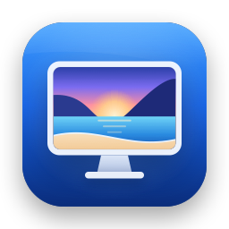
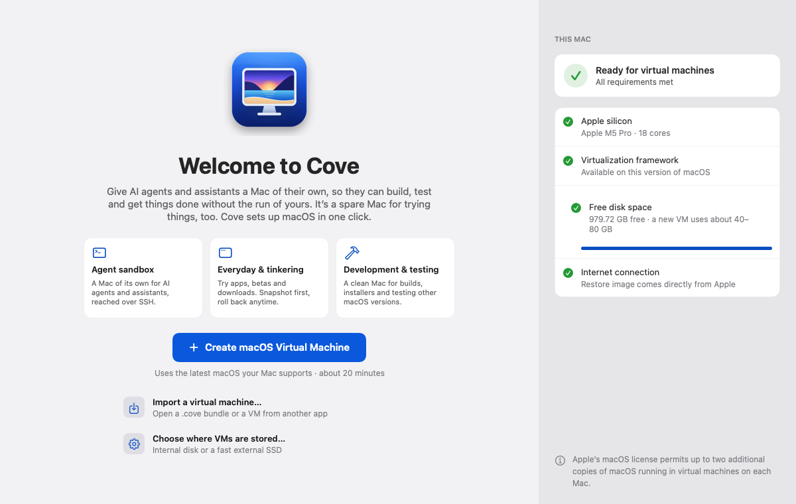
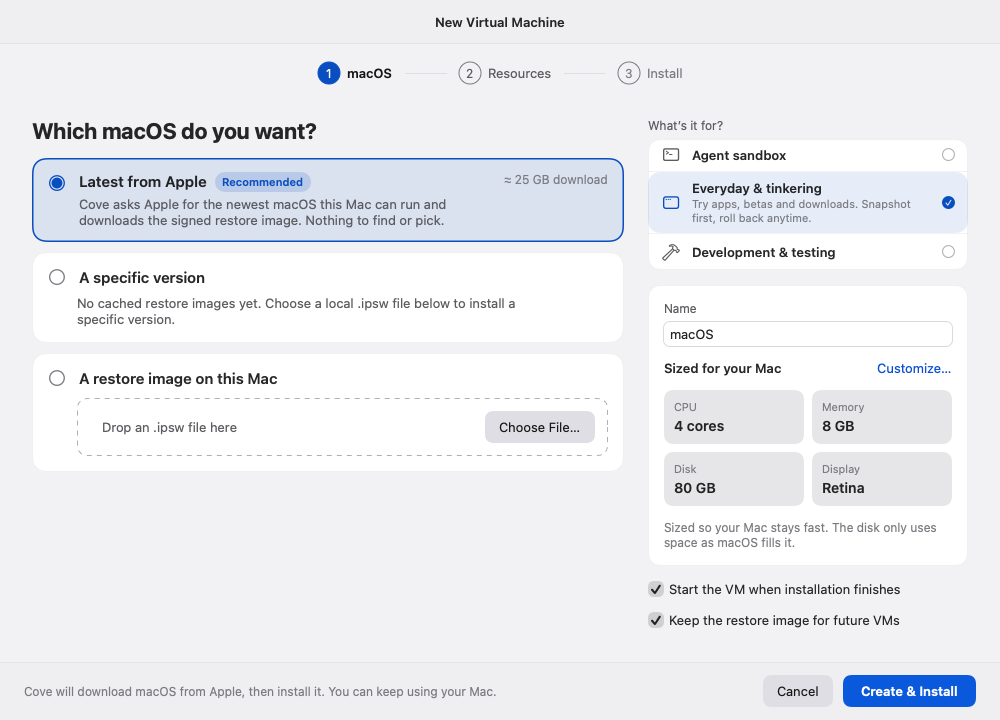
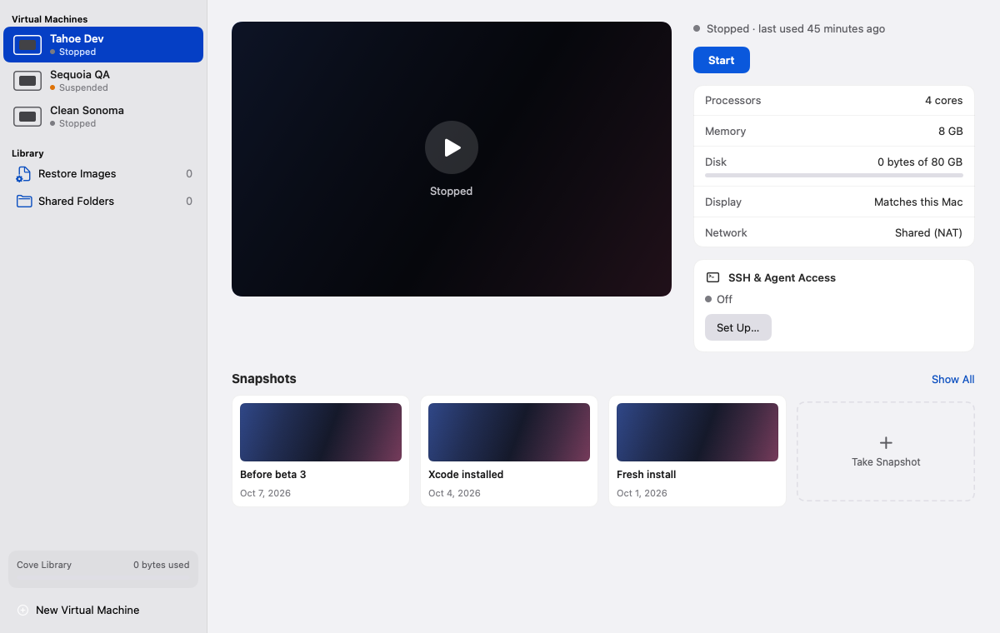
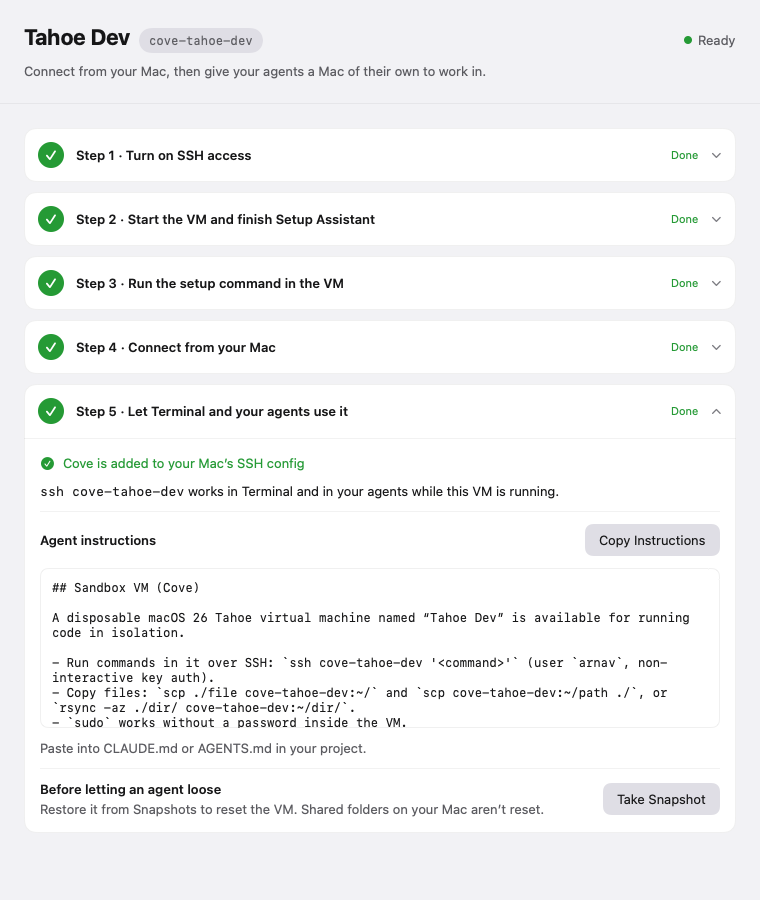

<div align="center">



# Cove

**A Mac of their own, for your AI agents.**

Cove is an agent-first virtual machine app for your Mac. It gives AI agents and assistants a real Mac to work in
— so you can prototype, build and automate quickly — without handing them the Mac you live on. It's also the
easiest way to get a spare Mac for testing and tinkering: one click downloads, installs and starts the latest
macOS, right on your desktop.

[](#requirements)
[](#requirements)
[](#build-from-source)
[](#how-it-works)
[](#install)

[Install](#install) · [Quick start](#quick-start) · [Connect your agents](#connect-your-agents) ·
[Safety model](#safety-model) · [FAQ](#faq) · [Docs](docs/README.md)

</div>

<br>

<picture>
  <source media="(prefers-color-scheme: dark)" srcset="docs/images/stats-dark.svg">
  <source media="(prefers-color-scheme: light)" srcset="docs/images/stats-light.svg">
  
</picture>

<sub>Install time measured with Cove's engine smoke test on an M5 Pro (macOS 27.0.1 restore image, October 2026).
Download time depends on your connection. Snapshots copy no disk data when your Cove library is on an APFS
volume, which is the default.</sub>

## Why Cove

AI agents are most useful when they can actually *do* things: install tools, run builds, click through apps,
change settings, try again. That's also exactly what you don't want happening on the Mac that holds your photos,
your accounts, your messages and your keychain.

Cove gives them somewhere else to work. Each Cove VM is a complete, separate macOS with its own disk, its own user
account and its own settings. Your agents reach it with one command — `ssh cove-<name>` — and you can watch along
in a window, take a snapshot before anything risky, and roll back in seconds if things go sideways.

- **Move fast with agents.** Let coding agents prototype, run software factories and automate workflows in a
  Mac that's theirs to break.
- **Bring an assistant, keep your keys.** Run a personal assistant inside a VM and sign it into only the accounts
  it needs — not your Mac's files, accounts, messages or keychain.
- **Keep a spare Mac for everything else.** Try apps, betas and risky downloads, test installers, or check how
  something behaves on a clean system. Snapshot first; roll back anytime.

## What you can do

<table>
<tr>
<td width="50%" valign="top">

### 🤖 Agent sandbox
Give Claude Code, Codex, Cursor or your own scripts a Mac to run commands in over SSH. Cove turns on SSH,
optional passwordless `sudo` and a “Fresh install” snapshot for you, then hands you a ready-to-paste
`CLAUDE.md` / `AGENTS.md` snippet.

</td>
<td width="50%" valign="top">

### 🏭 Software factories & prototyping
Spin up clean Macs for builds, installers and end-to-end tests. Clone a VM in seconds (APFS copy-on-write),
let agents iterate, and reset to a known-good snapshot between runs.

</td>
</tr>
<tr>
<td width="50%" valign="top">

### 🔐 A personal assistant without the keys to your Mac
Run an assistant *inside* the VM and sign it into only what it needs. Share a single folder — read-only if you
like — instead of your whole home folder. [How to set it up →](docs/personal-assistant.md)

</td>
<td width="50%" valign="top">

### 🧪 Test & tinker
Try apps, betas, settings and sketchy downloads somewhere that isn't your Mac. Take a snapshot first, and
restore it when you're done.

</td>
</tr>
</table>

When you create a VM, Cove asks **What's it for?** — **Agent sandbox**, **Everyday & tinkering** or
**Development & testing** — and sets sensible defaults for it. You can change any setting later.

## How it works

1. **Create.** Click **Create macOS Virtual Machine**. Cove asks Apple for the newest macOS your Mac can run,
   downloads the signed restore image and sizes the VM so your Mac stays fast.
2. **Install.** Cove installs macOS and starts it. You finish Apple's Setup Assistant in the VM window, just like
   on a new Mac. Keep using your Mac in the meantime; Cove sends a notification when the VM is ready.
3. **Use it.** Work in the VM window, or turn on **SSH & Agent Access** so you and your agents can reach it with
   `ssh cove-<name>`. Take snapshots along the way.

Under the hood Cove uses only Apple's [Virtualization.framework](https://developer.apple.com/documentation/virtualization)
— the same technology built into macOS. No kernel extensions, no QEMU, no helper tools. The app itself runs in
Apple's App Sandbox.

## Screenshots

<picture>
  <source media="(prefers-color-scheme: dark)" srcset="docs/images/screen-welcome-dark.png">
  
</picture>
<p align="center"><sub><b>Welcome</b> — pick what the VM is for, and Cove checks your Mac is ready</sub></p>

<table>
<tr>
<td width="50%" valign="top">
<picture>
  <source media="(prefers-color-scheme: dark)" srcset="docs/images/screen-new-vm-dark.png">
  
</picture>
<p align="center"><sub><b>New Virtual Machine</b> — latest macOS, sized for your Mac</sub></p>
</td>
<td width="50%" valign="top">
<picture>
  <source media="(prefers-color-scheme: dark)" srcset="docs/images/screen-library-dark.png">
  
</picture>
<p align="center"><sub><b>Library</b> — your VMs, their snapshots and SSH status</sub></p>
</td>
</tr>
</table>

<p align="center">
<picture>
  <source media="(prefers-color-scheme: dark)" srcset="docs/images/screen-ssh-agent-access-dark.png">
  
</picture>
<br>
<sub><b>SSH & Agent Access</b> — five guided steps to <code>ssh cove-&lt;name&gt;</code>, plus instructions for your agent</sub>
</p>

<sub>Screenshots use sample data.</sub>

## Install

### Requirements

- A Mac with **Apple silicon** (M1 or later). Intel Macs can't run macOS virtual machines.
- **macOS 14 Sonoma** or later.
- About **55 GB of free space** for your first VM (the macOS download plus the installed system). The download is
  kept for future VMs unless you choose otherwise.
- An internet connection — macOS comes straight from Apple.

### With Homebrew

```sh
brew install --cask arnavprabhu/tap/cove
```

### Approve Cove the first time you open it

Cove isn't notarized by Apple yet, so macOS can't check it for malware and stops it the first time it opens. You
approve it once, and after that it opens normally.

1. Open **Cove** from your Applications folder. macOS shows a message that it **can't verify** “Cove” — on
   macOS 15 or later it reads *“Apple could not verify “Cove” is free of malware that may harm your Mac or
   compromise your privacy.”* Click **Done**. (Don't click **Move to Trash**.)
2. Open **System Settings** and choose **Privacy & Security** in the sidebar.
3. Scroll down to the **Security** section. You'll see *“Cove” was blocked to protect your Mac.* Click
   **Open Anyway**.
4. In the dialog that appears, click **Open Anyway** again, then enter your Mac's password (or use Touch ID).

> [!NOTE]
> On macOS 15 Sequoia and later, Control-clicking the app and choosing **Open** no longer skips this check —
> use **Privacy & Security** as above. Please don't turn off Gatekeeper to run Cove.

<details>
<summary>Advanced: remove the quarantine flag from Terminal instead</summary>

If you're comfortable with Terminal, this tells macOS you trust this copy of Cove. Only do this for a copy you
installed from this project:

```sh
xattr -dr com.apple.quarantine /Applications/Cove.app
```

</details>

### Uninstall

```sh
brew uninstall --cask cove
```

This removes the app and keeps your virtual machines.

> [!WARNING]
> `brew uninstall --cask --zap cove` also deletes Cove's data — **every virtual machine, snapshot and downloaded
> macOS image**. There's no undo. Export or copy any VM you want to keep first.

If you added Cove to your SSH config, also delete `~/.ssh/cove/` and the `Include ~/.ssh/cove/config` line (and
the comment above it) from `~/.ssh/config`.

You can also [build Cove from source](#build-from-source).

## Quick start

1. Open Cove and click **Create macOS Virtual Machine** — or click one of the tiles to start with that purpose.
2. Under **What's it for?**, choose **Agent sandbox**, **Everyday & tinkering** or **Development & testing**,
   give the VM a name, and click **Create & Install**.
3. Wait for the download and install. You can close the window; Cove keeps going and tells you when it's done.
4. In the VM window, finish **Setup Assistant** and create a user account, as on a new Mac.
5. Take a snapshot whenever you reach a state you want to keep: **Virtual Machine ▸ Take Snapshot…** (⇧⌘S).

New to all this? The [getting started guide](docs/getting-started.md) walks through every step with plain
explanations.

<details>
<summary>Keyboard shortcuts</summary>

| Action | Shortcut |
|---|---|
| New Virtual Machine… / Import Virtual Machine… | ⌘N / ⇧⌘O |
| Show Library | ⌘0 |
| Start / Resume · Restart | ⌘R · ⌥⌘R |
| Pause · Suspend · Shut Down | ⌥⌘P · ⌥⌘U · ⌥⌘. |
| Take Snapshot… · Show Snapshots | ⇧⌘S · ⌥⌘S |
| VM Settings… · SSH & Agent Access… · Show in Finder | ⌘I · ⇧⌘K · ⇧⌘R |
| Give the keyboard and pointer back to your Mac | ⌃⌥ (or ⌃⌥⌘ — App Settings ▸ General) |

While a running VM has keyboard focus, ⌘ shortcuts go to the VM. Press ⌃⌥ to give the keyboard back to Cove.

</details>

## Connect your agents

Open **SSH & Agent Access** for a VM (⇧⌘K, the **SSH** button in the VM window, or the VM's menu in the
Library). It walks you through five steps and shows live status for each:

1. **Turn on SSH access.** (Already on for **Agent sandbox** VMs.)
2. **Start the VM and finish Setup Assistant.**
3. **Run the setup command in the VM** — type it in the VM's Terminal:
   ```sh
   sh "/Volumes/My Shared Files/Cove/setup.sh"
   ```
4. **Connect from your Mac** — Cove shows the VM's address and whether SSH is reachable.
5. **Let Terminal and your agents use it** — click **Add Cove to ~/.ssh/config…**.

Now anything on your Mac can use the VM:

```sh
ssh cove-agent-sandbox 'sw_vers'
scp ./build.zip cove-agent-sandbox:~/
rsync -az ./project/ cove-agent-sandbox:~/project/
```

Then click **Copy Instructions** and paste them into your project's `CLAUDE.md` or `AGENTS.md`, so your agent
knows the VM is there:

```md
## Sandbox VM (Cove)

A disposable macOS 27.0.1 virtual machine named “Agent Sandbox” is available for running code in isolation.

- Run commands in it over SSH: `ssh cove-agent-sandbox '<command>'` (user `you`, non-interactive key auth).
- Copy files: `scp ./file cove-agent-sandbox:~/` and `scp cove-agent-sandbox:~/path ./`, or `rsync -az ./dir/ cove-agent-sandbox:~/dir/`.
- `sudo` works without a password inside the VM.
- Prefer doing risky or system-level work (installs, config changes, untrusted code) in the VM, not on the host.
- The VM can be reset by restoring a snapshot in Cove — ask the user before assuming it is clean.
```

There are two ways to work, and they protect you differently:

| | Agent runs on your Mac, works in the VM | Agent runs inside the VM |
|---|---|---|
| **Set up** | The steps above | Install the agent in the VM and sign it in there |
| **Good for** | Coding agents running builds, tests and installs | Assistants and long-running, unattended work |
| **What the VM protects** | Everything the agent *runs in the VM* | Everything — the agent only ever sees the VM |
| **Keep in mind** | The agent itself still runs on your Mac, with whatever access you give it there | Sign it in only to accounts it needs |

Full walkthrough: **[SSH & agent access](docs/ssh-and-agents.md)** · Running an assistant in a VM:
**[Personal assistant guide](docs/personal-assistant.md)**

## Safety model

A Cove VM is a separate Mac. Here's what it can and can't reach.

**What the VM can't see**

- **Your files.** The VM has its own virtual disk. It sees nothing from your Mac except folders you choose to
  share.
- **Your accounts, messages and keychain.** The VM has its own user account, its own keychain and its own sign-ins.
  Nothing is signed in unless you sign it in inside the VM.
- **Your clipboard.** macOS virtual machines don't support clipboard sharing, so nothing you copy on your Mac
  appears in the VM (and vice versa).

**What the VM *can* reach — and how to limit it**

- **Folders you share.** Shared folders appear in the VM under `/Volumes/My Shared Files`. They're **read & write
  unless you set them to Read only** (VM **Settings ▸ Sharing**). Restoring a snapshot doesn't undo changes made to
  shared folders.
- **The internet and your network.** VMs use **Shared (NAT)** networking through your Mac's connection. The VM can
  reach the internet and, like any device on your network, other devices and services it can address — including
  services your Mac offers on its network. Set **Network** to **Disconnected** for a fully offline VM (SSH
  access needs the network).
- **The Cove folder.** With SSH access on, the VM also sees a small **Cove** folder holding the setup script and
  Cove's *public* SSH key. Your private key never leaves your Mac.
- **Administrator rights inside the VM.** If you allow passwordless `sudo`, agents can change anything *in the
  VM*. That doesn't extend to your Mac.

**Resetting**

- **Snapshots** save the VM's disk (and memory, if it's running) as an instant APFS clone. Restore one to go back
  in time; Cove saves the current state first, so you can change your mind.
- **Clones** make an independent copy of a VM with a new identity in seconds.

**Limits to be aware of**

- If your agent runs **on your Mac** and uses the VM over SSH, the agent program itself isn't sandboxed by Cove.
  For the strongest separation, run the agent **inside** the VM.
- A VM isn't a security boundary against a determined attacker who can exploit macOS or Virtualization.framework
  itself. Treat it as a strong, convenient separation, not a guarantee.
- Anything with access to `~/.ssh/cove/` on your Mac can log in to your VMs.

## FAQ

<details>
<summary><b>Does Cove work on Intel Macs?</b></summary>

No. macOS virtual machines need Apple silicon. Cove is built for Apple silicon only and shows an explanation if
you open it somewhere it can't run (for example, inside another VM).
</details>

<details>
<summary><b>Can I run Linux or Windows?</b></summary>

Not today. Cove creates macOS virtual machines only.
</details>

<details>
<summary><b>Why can only two VMs run at once?</b></summary>

Apple's macOS license allows up to two additional copies of macOS running in virtual machines on each Mac. You
can *create* as many VMs as you have room for; Cove offers to suspend one when you start a third.
</details>

<details>
<summary><b>How much disk space does a VM use?</b></summary>

The macOS download is about 25–27 GB (26.6 GB for macOS 27.0.1) and is kept for future VMs unless you turn that
off. Each VM's disk is *sparse*: an 80 GB disk only takes up the space macOS has actually written — roughly
25 GB for a fresh install. Cove checks for about 55 GB free before it installs. Snapshots and clones share unchanged
data with the original, so they start out nearly free.
</details>

<details>
<summary><b>Can I copy and paste between my Mac and the VM?</b></summary>

No — macOS virtual machines don't support clipboard sharing. Use a shared folder, or `scp` / `rsync` over SSH.
That's also why the SSH setup command is typed by hand in the VM.
</details>

<details>
<summary><b>Can I sign in with my Apple Account in the VM?</b></summary>

Apple supports Apple Account sign-in in virtual machines when both your Mac and the VM run macOS 15 or later;
some features may still be limited. For agent and assistant VMs we suggest a separate Apple Account, or none at
all — see the [personal assistant guide](docs/personal-assistant.md).
</details>

<details>
<summary><b>Can I install an older macOS?</b></summary>

Yes, if you have its restore image (`.ipsw`). In **New Virtual Machine**, choose **A specific version** (images
you've downloaded before) or **A restore image on this Mac**. Cove can't browse Apple's full catalog for you, and
your Mac generally can't run a macOS newer than its own.
</details>

<details>
<summary><b>Can the VM join my local network directly (bridged networking)?</b></summary>

Not yet. Bridged networking needs a special permission from Apple that Cove doesn't have, so VMs use Shared (NAT)
networking.
</details>

<details>
<summary><b>Where are my VMs stored?</b></summary>

By default in `~/Library/Containers/app.cove.Cove/Data/Library/Application Support/Cove`. To use another disk
(a fast external SSD works well), open **Cove ▸ Settings… ▸ Storage** and click **Move…** while all VMs are
stopped. Keep the library on an APFS-formatted disk so snapshots and clones stay instant.
</details>

<details>
<summary><b>Is Cove notarized?</b></summary>

Not yet. Cove is ad-hoc signed, which is why macOS asks you to approve it in **Privacy & Security** the first
time. See [Install](#install).
</details>

<details>
<summary><b>Does Cove collect any data?</b></summary>

Cove has no analytics or tracking. macOS restore images are downloaded directly from Apple.
</details>

More answers: **[Troubleshooting](docs/troubleshooting.md)**.

## Build from source

You'll need Xcode (with the macOS 14 SDK or later) and [XcodeGen](https://github.com/yonaskolb/XcodeGen).

```sh
brew install xcodegen
git clone https://github.com/arnavprabhu/cove.git && cd cove
scripts/install.sh           # builds a Release copy and installs it to /Applications
```

`scripts/install.sh` replaces any previous copy (running VMs are suspended first; your library is untouched).
To work on Cove:

```sh
xcodegen generate            # creates Cove.xcodeproj from project.yml (not checked in)
open Cove.xcodeproj          # or build and test from the command line:
xcodebuild -project Cove.xcodeproj -scheme Cove -derivedDataPath build/dd build
xcodebuild -project Cove.xcodeproj -scheme Cove -derivedDataPath build/dd test
```

Builds are ad-hoc signed with the `com.apple.security.virtualization` entitlement and the App Sandbox.

<details>
<summary>Engine smoke test, screen renders and app icon</summary>

**Engine smoke test** — exercises the real pipeline end to end:

```sh
APP=build/dd/Build/Products/Debug/Cove.app/Contents/MacOS/Cove
$APP -coveSmoke fetch     # resolve the latest restore image from Apple
$APP -coveSmoke install   # download → create → install → boot → suspend → resume → stop
```

Verified on an M5 Pro (macOS 27.0.1 host, 2026-10-11): `install` downloaded the 26.6 GB macOS 27.0.1 image,
installed it, took the “Fresh install” APFS-clone snapshot, booted, suspended to a save file, resumed from it and
stopped.

**Screen renders** — Debug builds render every screen with sample data, dark and light, to PNGs:

```sh
OUT=~/Library/Containers/app.cove.Cove/Data/tmp/render   # the sandboxed app can only write inside its container
$APP -coveRender $OUT
```

**App icon** — drawn in code so it stays crisp at every size:

```sh
for s in 16 32 64 128 256 512 1024; do swift scripts/make-icon.swift Resources/Assets.xcassets/AppIcon.appiconset/icon_$s.png $s; done
```

</details>

<details>
<summary>On-disk format</summary>

```
<Library>/VMs/<Name>.cove/          document package (UTI app.cove.vm)
  config.json  HardwareModel  MachineIdentifier  AuxiliaryStorage  Disk.img (sparse)
  SaveState.vzvmsave               only while suspended
  Snapshots/<uuid>/                meta.json, Disk.img, AuxiliaryStorage, SaveState?, config.json  (APFS clones)
  Guest/                           the “Cove” shared folder (setup.sh, public key) when SSH access is on
  Thumbnail.png
<Library>/RestoreImages/*.ipsw     (+ .resume data for interrupted downloads)
<Library>/SSH/cove_ed25519(.pub)   the library's SSH key pair
```

</details>

<details>
<summary>Known limitations</summary>

- Not notarized (ad-hoc signed); see [Install](#install).
- Apple silicon only; macOS guests only.
- No clipboard sharing with macOS guests (a Virtualization.framework limitation).
- Bridged networking is implemented but compiled out until Apple grants the `com.apple.vm.networking`
  entitlement (then add it and the `COVE_BRIDGED` compilation condition).
- **Export…** copies the `.cove` package without its snapshots or saved state.
- **A specific version** lists only restore images already in your library, plus any `.ipsw` you pick.
- Guest CPU and memory *usage* aren't exposed by Virtualization.framework, so Cove shows allocated resources.

</details>

## Project layout

| Folder | Contents |
|---|---|
| `App/` | App entry point, windows, menus and commands |
| `Engine/` | Virtualization.framework: VM bundles, configuration, sessions, install pipeline, resumable download, snapshots, SSH & agent access |
| `Model/` | Settings, state, purposes and the resource planner (pure Swift, unit-tested) |
| `UI/` | Theme, shared components and alerts |
| `Features/` | One folder per screen — Welcome, NewVM, Install, Library, Console, Snapshots, RemoteAccess, MenuBar, VMSettings, AppSettings, Alerts |
| `Resources/` | Info.plist, entitlements, asset catalog |
| `CoveTests/` | Unit tests |
| `docs/` | User guides and README images |
| `scripts/` | Install script and icon generator |

## Acknowledgements & license

Cove is built entirely on Apple's [Virtualization.framework](https://developer.apple.com/documentation/virtualization),
SwiftUI and AppKit, and uses [XcodeGen](https://github.com/yonaskolb/XcodeGen) to generate its Xcode project.
macOS is © Apple Inc. and is downloaded directly from Apple; use it in accordance with Apple's macOS license.

**License:** not yet chosen — this repository doesn't include a LICENSE file yet.
